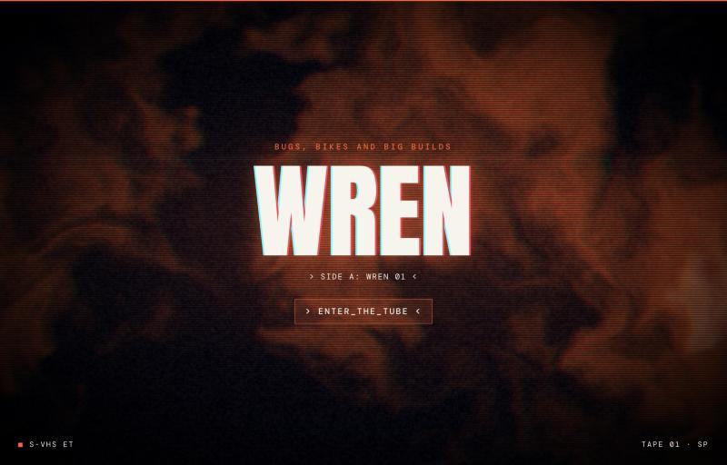
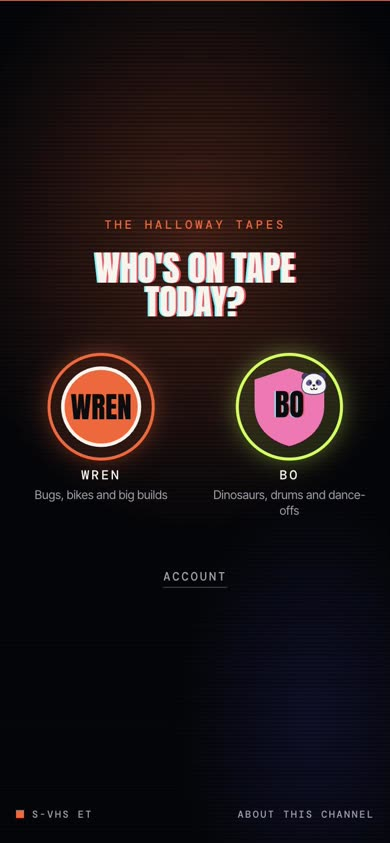
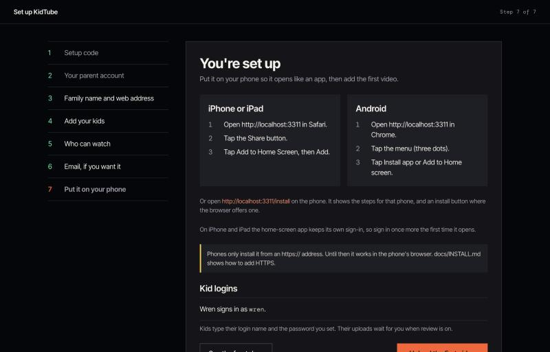
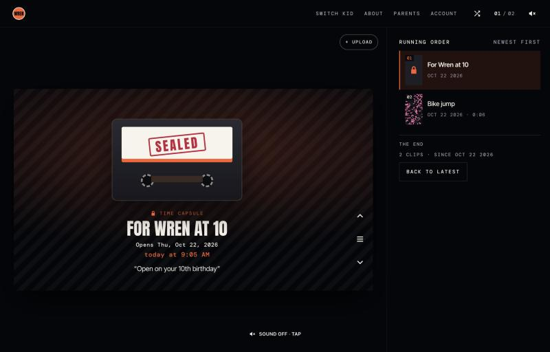
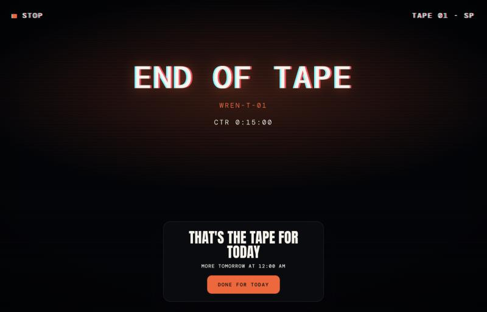
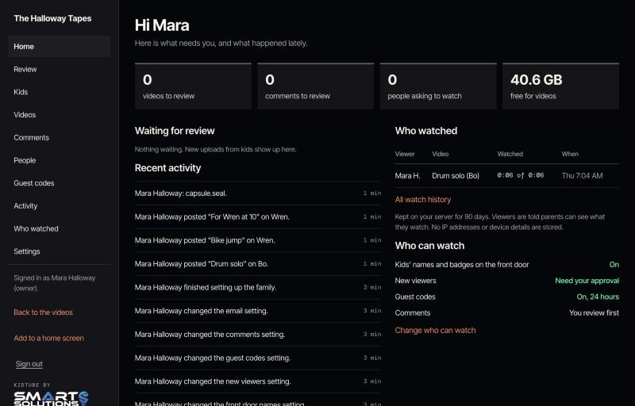
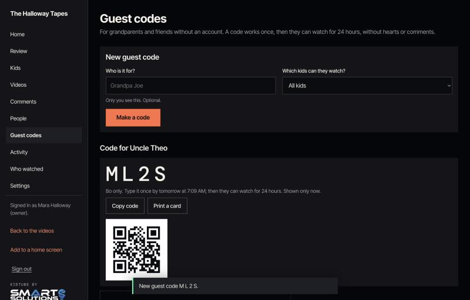

<p align="center">
  
</p>

# KidTube

**Your kid's first YouTube channel, with an audience you choose.**

KidTube gives each kid in your family their own little video channel. They design the badge, pick the intro and
post the videos. You run it on a computer at home, decide who can watch, and see every upload before it goes
live. No ads, no algorithm, no strangers.

*A little channel. A big imagination.*

<p align="center">
  
  &nbsp;
  
</p>

The families in these pictures are made up, and so are their videos.

## What everyone gets

**Kids**

- A channel of their own: their name, a line about them, a colour, and a badge they design with shapes and
  stickers. No photo of your child is needed anywhere.
- An intro that plays when someone opens their channel. Six to pick from: a VHS tape, an arcade cabinet, a comic
  cover, a creature file, a blueprint and a calm glass one.
- Posting from a phone: "What's it called?", then "Record it to tape". If you review uploads, they see "Sent to a
  parent" and it goes live when you say yes.
- Time capsules: a video sealed until a birthday, with a note, that opens on the day.

**Parents**

- One calm dashboard at `/parents`: videos waiting for review, comments, who asked to watch, who watched what,
  guest codes, an activity feed and settings.
- Nobody watches until you approve them. Kids' uploads and new comments wait for you by default.
- A daily watch limit per kid, if you want one. When it runs out the channel shows "End of tape" and stops.
- Everything stays on your own computer. Videos, names and watch history never go anywhere else.

**Family**

- Grandparents, cousins and friends ask to watch from the front door, and you let them in by name.
- Or give someone a guest code for 24 hours, limited to one kid if you like, with a card to print and a QR.
- Hearts, sticker reactions and comments, and the app on their home screen like any other.

## Install in three lines

On a computer that stays on, with [Docker](https://docs.docker.com/get-docker/):

```bash
git clone https://github.com/SmartSolutionsHQ/KidTube.git kidtube && cd kidtube
docker compose up -d
docker logs kidtube
```

The last command shows a setup link and a one-time code. Open the link, type the code, and a seven-step setup
walks you through your parent account, your family's name, each kid's channel, who can watch, optional email,
and putting it on your phone.

<p align="center">
  
</p>

[docs/INSTALL.md](docs/INSTALL.md) has the whole thing in plain words: a mini PC or NAS, phones on your home
Wi-Fi, private HTTPS with Tailscale and no domain, your own domain, an existing reverse proxy, and running it
without Docker.

## Why not YouTube Kids?

YouTube Kids is built for watching. KidTube is built for making.

| | YouTube Kids | KidTube |
|---|---|---|
| Whose videos | Other people's channels | Your kids' own |
| Who picks what plays | Recommendations, unless you hand-pick every video | Your kid's videos, newest first |
| Who can watch your kid | Your kid can't post there | People you approved by name |
| Ads | Yes | None |
| Where it runs | Google's servers | A computer in your home |

KidTube is not affiliated with YouTube or Google.

## Privacy at a glance

- **It runs on your box.** Videos, accounts, comments and watch history live in one folder on your computer. No
  analytics, no outside requests; fonts and stickers ship with the app.
- **You choose the audience.** Every viewer is approved by a parent, or holds a guest code you made. Videos,
  posters, titles and comments always need a sign-in. Kids' names and badges on the front door are on by
  default; one switch turns them off.
- **You see what was watched.** Who watched which video, and how much, is kept for 90 days and only parents see
  it. Viewers are told when they sign up. No IP addresses or device details are stored.
- **Phone details are stripped.** Uploads are converted on the box, and the location and other details phones
  hide in videos are removed.
- **Email is optional.** With it on, Brevo sends approval and new-video notices; with it off, nothing leaves.
- **The home-screen app keeps only the app's look** (styles, scripts, fonts) on the phone, never videos or
  anything private.

[SECURITY.md](SECURITY.md) has the details and how to report a problem.

## A look around

<p align="center">
  
  
</p>
<p align="center">
  
  
</p>

## Running it

- [docs/INSTALL.md](docs/INSTALL.md): installing, HTTPS, phones, and a tour of the parent dashboard
- [docs/UPGRADING.md](docs/UPGRADING.md): updating, rolling back, and moving an older family site onto KidTube
- [docs/OPERATIONS.md](docs/OPERATIONS.md): backups, restores, account recovery and troubleshooting
- [docs/EMAIL.md](docs/EMAIL.md): optional email with Brevo's free plan
- [docs/THEMES.md](docs/THEMES.md): how splash themes work, and how to make one
- [CHANGELOG.md](CHANGELOG.md): what changed in each version

## Contributing

KidTube has no runtime dependencies and no build step. It needs Node 24 and FFmpeg to run the tests:

```bash
npm test
```

Keep changes generic and test them on a scratch install, never on a family's real one. Never attach a real
`.env`, database, backup or video to an issue. [docs/VERIFY.md](docs/VERIFY.md) is the checklist we run before a
release, and [docs/RENAMING.md](docs/RENAMING.md) lists where the product name lives.

## By Smart Solutions

KidTube is made by [Smart Solutions](https://smartsolutions.fyi). It started as one family's channel and grew into
something any family can run.


MIT licensed. Hardware, storage, power and a domain, if you want one, are yours to provide.
